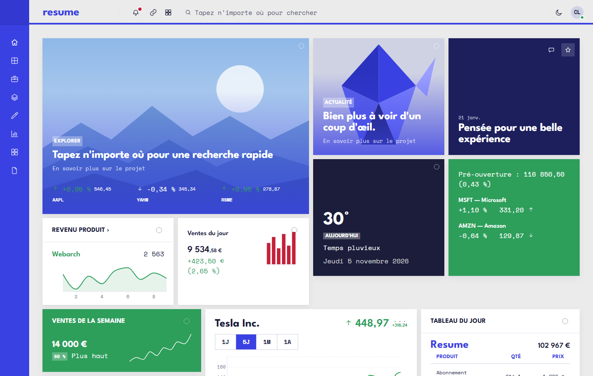
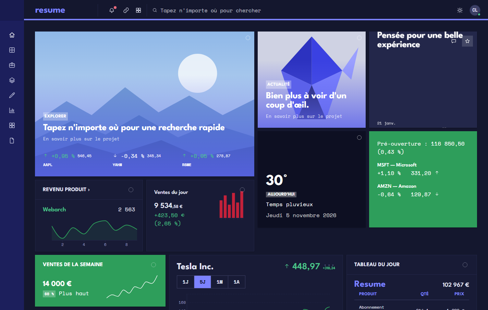
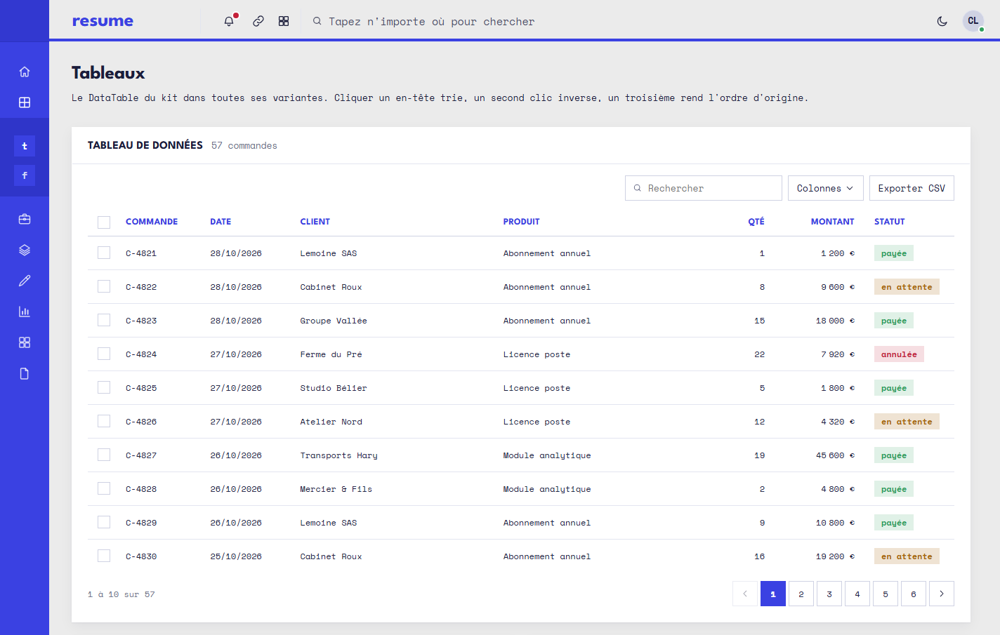
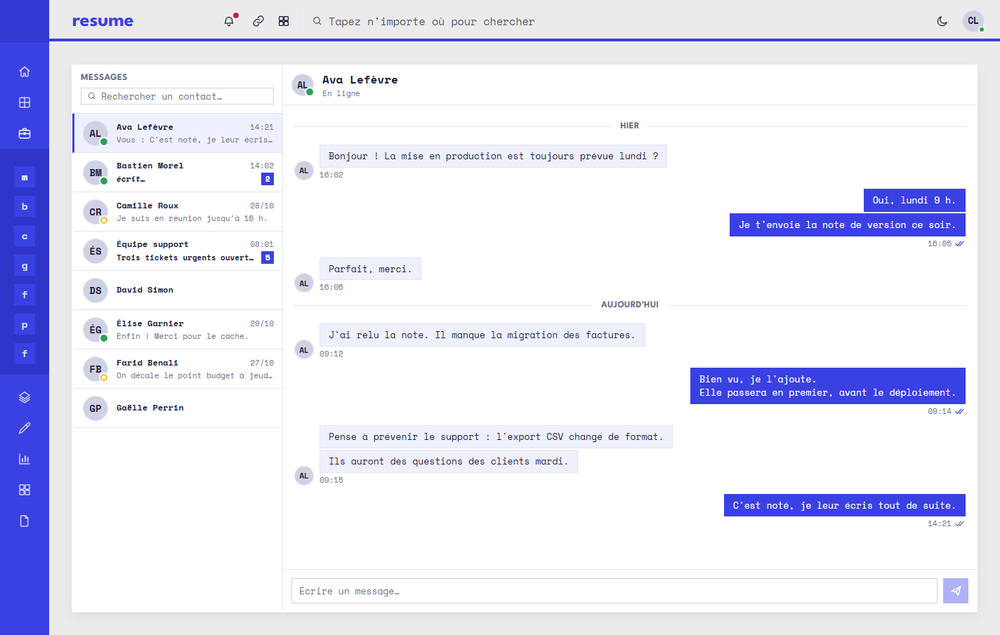
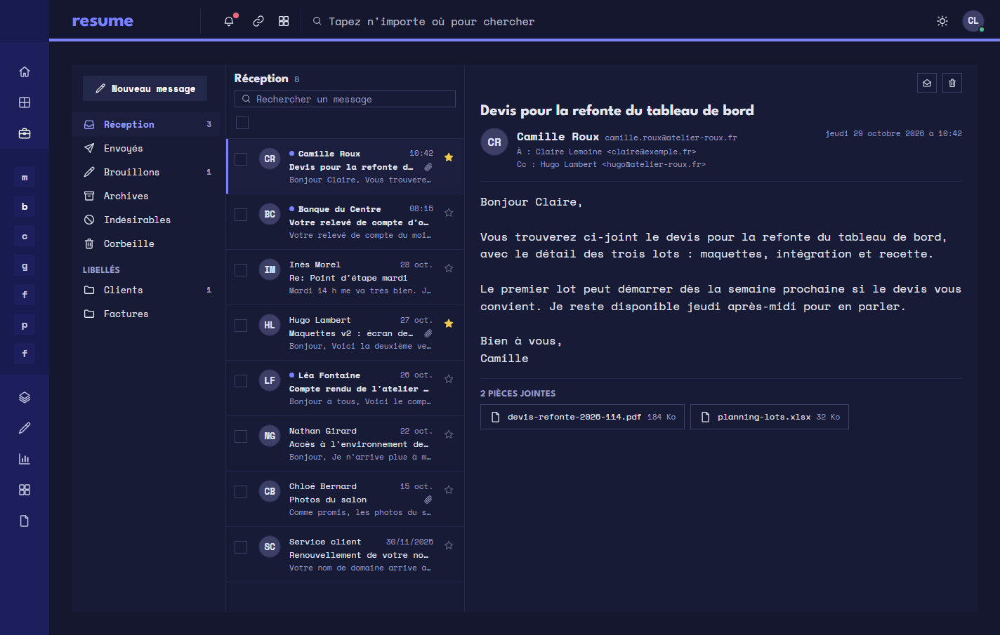
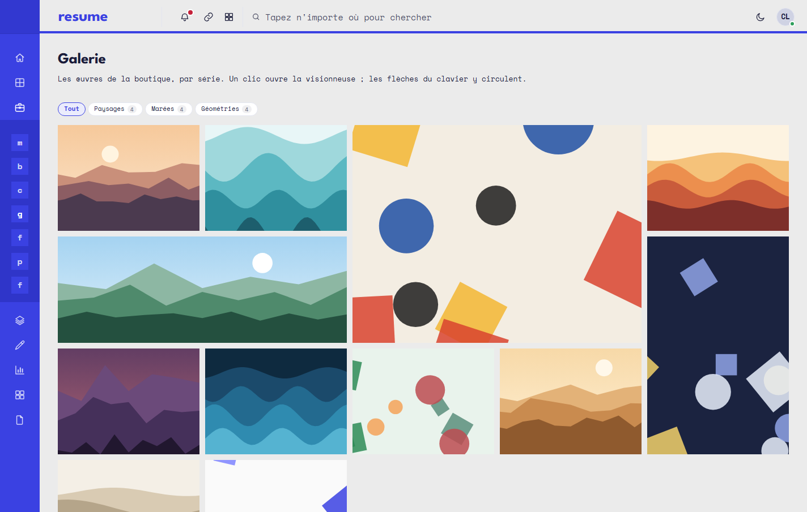
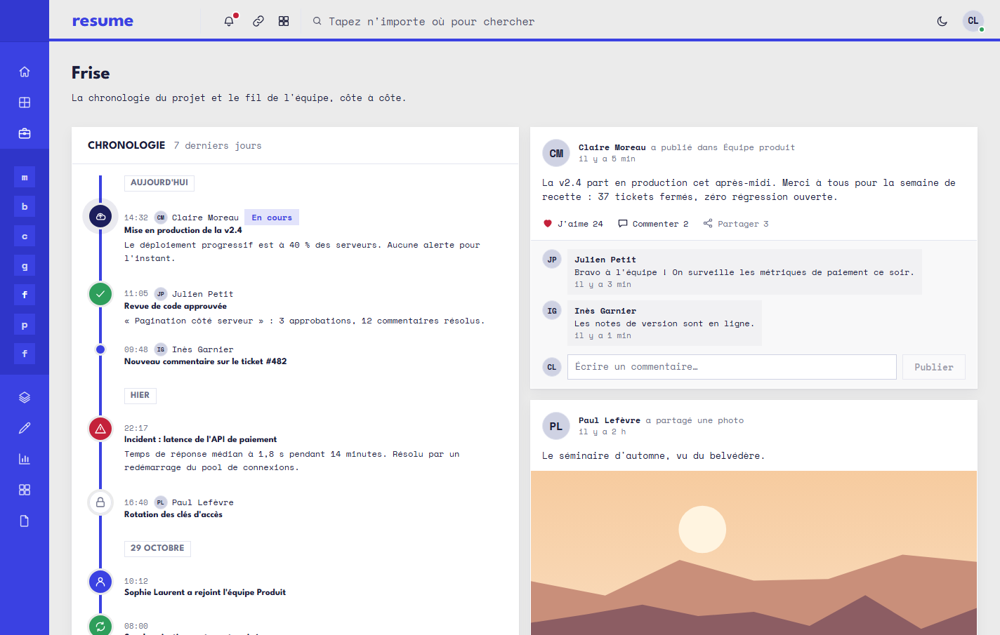
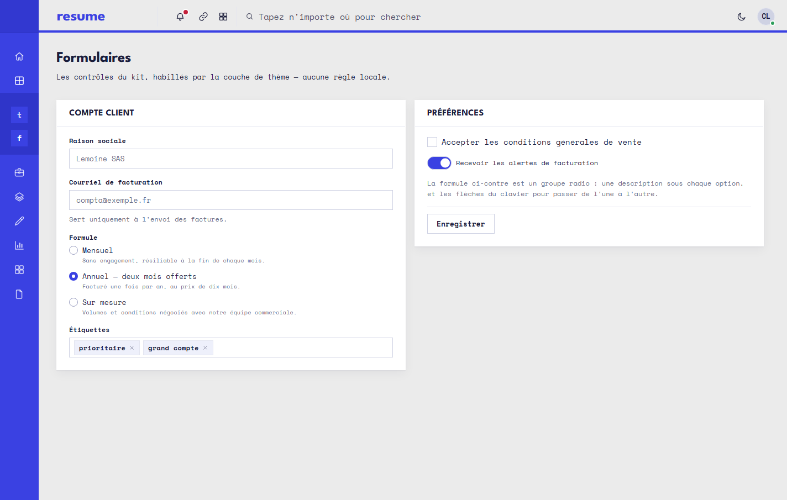
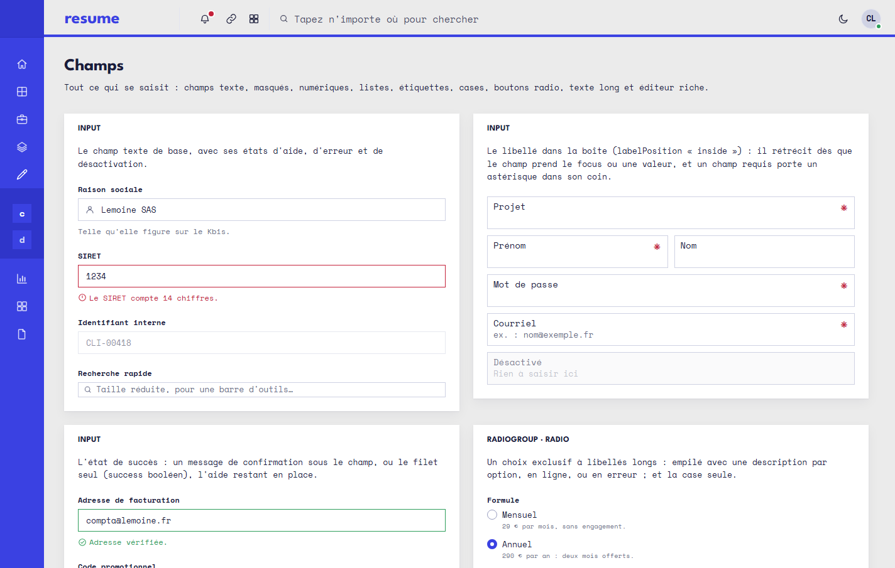

# resume-dashboard-kit

Une **couche de thème** par-dessus [`@michaelthomasjach/liseuse-dashboard-kit`](https://github.com/michaelthomasjach/liseuse-dashboard-kit),
et la vitrine qui la montre. Elle habille les composants du kit du **style graphique du CV de
Michael Jach** : bleu électrique, Space Mono, League Spartan, angles droits.

Le kit porte la logique des composants ; ce dépôt ne porte que leur apparence, plus les écrans de
démonstration. Aucun composant n'est réécrit ici tant qu'une variable suffit à le rhabiller.

**En ligne :** [Storybook](https://michaelthomasjach.github.io/resume-dashboard-kit/) — chaque composant, son code et ses props ·
[Vitrine](https://michaelthomasjach.github.io/resume-dashboard-kit/vitrine/) — le tableau de bord, les écrans d'application et une planche par famille.

## Aperçu



| | |
|---|---|
|  |  |
| **Surface sombre** — la version nuit du site du CV | **Tableaux** — pagination, recherche, sélection, export, en-tête figé |
|  |  |
| **Messagerie** — `ChatPanel` | **Boîte mail** — `MailPanel`, en sombre |
|  |  |
| **Calendrier** — `MonthCalendar` | **Galerie** — `Gallery` et sa visionneuse |
|  |  |
| **Frise et fil d'activité** — `Timeline`, `ActivityFeed` | **Formulaires** — champs à libellé intégré |



Les illustrations des écrans sont générées en code (SVG), aux couleurs du thème.

## Le style du CV

Le CV (site et PDF A4, dépôt voisin `../my-resume`) a un langage net, celui d'une fiche technique :

- un **bleu électrique `#3a41e2`** qui porte tout — le nom, la colonne de gauche pleine où le texte
  passe en blanc, le **filet de 4 px** sous le titre ;
- un **papier gris clair `#ebebeb`**, des surfaces blanches, une encre `#1b1d3a` et un gris
  `#6b6f8a` pour le texte atténué ;
- le corps en **Space Mono**, une chasse fixe ; le nom et les intitulés en **League Spartan 700**,
  en capitales pour les titres de carte et les en-têtes ;
- **aucun arrondi**, nulle part.

Les valeurs ne sont pas estimées : ce sont celles des variables CSS du site du CV
(`my-resume-front/src/styles.css` et `cv/Resume.module.css`), reportées dans
[`src/theme/resume.css`](src/theme/resume.css), qui fait foi. Ce qui en découle :

| | Surface claire — le CV | Surface sombre — sa version nuit |
|---|---|---|
| Accent | `#3a41e2` | `#7c82ff` |
| Texte | `#1b1d3a` | `#e4e6f5` |
| Texte atténué | `#6b6f8a` | `#9a9ec0` |
| Panneau (cartes) | `#ffffff` | `#181b36` |
| Fond | `#ebebeb` | `#14172e` |
| Barre latérale | `#3a41e2`, texte blanc | `#1c1f5c`, texte blanc |

La barre latérale est la colonne bleue pleine du CV ; la barre haute est posée sur le papier,
soulignée du filet bleu de 4 px. Les cartes n'ont pas de bordure, un simple souffle d'ombre les
détache du fond. Les petits titres (en-têtes de tableau, étiquettes) sont en League Spartan 700, les
en-têtes de tableau dans le bleu de l'accent, comme les « Skills: » du CV.

## Utiliser le paquet

Publié sur GitHub Packages sous `@michaelthomasjach/resume-dashboard-kit`. Il ré-exporte **tous**
les composants du kit et ajoute `ResumeTheme` : une seule dépendance à déclarer.

```ini
# .npmrc de l'application — le jeton reste une variable d'environnement
@michaelthomasjach:registry=https://npm.pkg.github.com
//npm.pkg.github.com/:_authToken=${GITHUB_TOKEN}
```

```sh
npm install @michaelthomasjach/resume-dashboard-kit react react-dom d3
```

```tsx
import { ResumeTheme, Card, DataTable } from "@michaelthomasjach/resume-dashboard-kit";
import "@michaelthomasjach/resume-dashboard-kit/style.css";

<ResumeTheme surface="light">
  <App />
</ResumeTheme>;
```

Les polices (Space Mono, League Spartan) sont embarquées via `@fontsource` et importées par
`ResumeTheme` : rien n'est demandé à Google Fonts. Pour publier une nouvelle version :
`npm version patch|minor`, puis `npm publish` (`prepublishOnly` construit `dist-lib/` avec
`vite.config.lib.ts`).

## Comment ça marche

Le kit ne code aucune couleur, aucun rayon, aucun espacement en dur : ses ~220 composants lisent
tous des variables CSS `--lq-*` posées sur leur ancêtre `.lq-root`. Ce dépôt les redéfinit dans
[`src/theme/resume.css`](src/theme/resume.css), sous un sélecteur strictement plus spécifique que
ceux du kit — donc gagnant quel que soit l'ordre des imports.

```
.rdk.lq-root[data-lq-palette][data-lq-surface="light"]   (0,4,0)  >  .lq-root[data-lq-palette="color"][data-lq-surface="light"]   (0,3,0)
.rdk.lq-root                                             (0,2,0)  >  .lq-root                                                     (0,1,0)
```

La classe `rdk` est posée par `ResumeTheme`, seul point d'entrée de la couche :

```tsx
import { ResumeTheme } from "./theme";

<ResumeTheme surface="light">
  <App />
</ResumeTheme>;
```

## Ce qui va où

| | Dépôt |
|---|---|
| Logique d'un composant, correctif, composant manquant | **le kit** |
| Couleurs, rayons, espacements, échelle typographique | **ici**, `src/theme/resume.css` |
| Refonte d'anatomie (densité, chrome, position d'un libellé) | **ici**, `src/theme/` — un composant qui enveloppe celui du kit |
| Écrans, navigation, données de démonstration | **ici**, `src/showcase/` |

La règle qui tranche : une variable ne peut pas **déplacer** un élément. Tant qu'il s'agit de
couleur, de taille ou d'espace, c'est `resume.css`. Dès qu'il faut qu'un libellé passe à gauche ou
qu'un en-tête descende sous un filet, c'est un composant.

Et un corollaire qu'on tient : **aucun contournement local d'un manque du kit**. S'il manque une
variable ou une prop, on l'ajoute dans le kit, pas ici — sinon les deux dépôts divergent et la
couche perd sa raison d'être.

## Démarrer

```bash
npm install          # a besoin de GITHUB_TOKEN dans le shell — le kit est sur GitHub Packages
npm run dev          # la vitrine
npm run storybook    # le Storybook, port 6007
```

`npm run build` lance le typecheck puis construit la vitrine ; `npm run build:lib` construit le
paquet.

## Ajouter un écran

Un seul geste. Le registre [`src/showcase/screens/index.tsx`](src/showcase/screens/index.tsx)
produit à la fois le menu et les routes, qui ne peuvent donc pas se contredire :

```tsx
export const SCREENS: Screen[] = [
  …,
  { id: "factures", label: "Factures", path: "factures", group: "Données", render: () => <Invoices /> },
];
```
